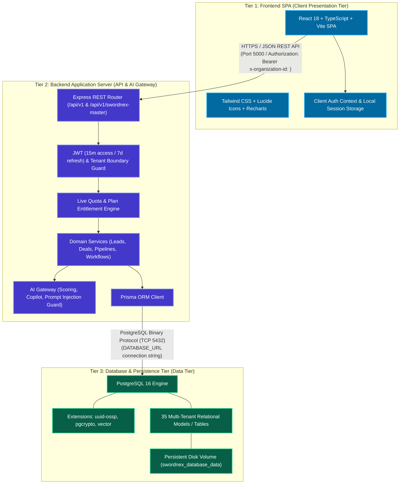

# SwordNex AI CRM — System Architecture Guide

> **Company:** SwordNex Technologies Private Limited  
> **Product:** SwordNex AI CRM (Intelligent Enterprise Multi-Tenant Cloud CRM)  
> **Architecture:** Decoupled 3-Tier Multi-Tenant SaaS (React 18 + Node.js 20 LTS + PostgreSQL 16)  
> **Version:** 1.0.0 Production Architecture  

---

## 1. System Topology & Separation Boundary

SwordNex AI CRM is built upon a strictly decoupled, 3-tier enterprise architecture separating the **Frontend Client**, the **Backend REST API Server**, and the **Database Tier**. Each tier can be developed, tested, built, scaled, and deployed completely independently.

---

## 2. Directory Separation & Responsibilities

| Directory | Tier | Primary Responsibility | Independent Runtime |
| :--- | :--- | :--- | :--- |
| **`client/`** | **Tier 1: Frontend Client** | Single Page Application, UI components, client-side routing, dashboards, and analytics charts. | Node.js 18+ / Vite / Nginx Alpine / CDN |
| **`server/`** | **Tier 2: Backend Server** | REST API endpoints, RBAC authentication, business logic, background automations, AI Gateway. | Node.js 18+ / Express / TypeScript / Prisma |
| **`database/`** | **Tier 3: Database Tier** | PostgreSQL database initialization scripts, extension setup, migrations, backups, and standalone Docker compose. | PostgreSQL 16 + pgvector |

---

## 3. Platform Portals & Access Control Separation

SwordNex AI CRM enforces a strict distinction between global platform administrators and tenant workspace members:

| Level | Role Type | Location | Responsibilities & Scope |
| :--- | :--- | :--- | :--- |
| **Global Platform** | `SUPER_ADMIN` | `User.globalRole` | Full access to SwordNex Master Head Office (`/swordnex-master`), cross-tenant subscription management, dynamic plan pricing in INR, global MRR/ARR analytics, and immutable platform security audit logs. Must be provisioned securely via server environment, never via public registration. |
| **Global Platform** | `USER` | `User.globalRole` | Standard registered platform identity. Default for all customer signups and invited team members. Lacks access to master head office. |
| **Tenant Workspace** | `ADMIN` (Customer Admin) | `Membership.role` | Administrative authority within the specific tenant organization: invite/manage members, configure custom roles and permissions, initiate plan upgrades/downgrades, and inspect organization audit logs. |
| **Tenant Workspace** | `USER` (Employee) | `Membership.role` | Scoped team member within the organization. Permissions are dynamically governed by an assigned custom `Role` (`Membership.customRoleId`). |
| **Dynamic Custom RBAC** | Custom Role Matrix | `Role` & `RolePermission` | Custom granular module permissions across 8 distinct actions (`VIEW`, `CREATE`, `EDIT`, `DELETE`, `APPROVE`, `EXPORT`, `ASSIGN`, `MANAGE`) across 12 modules (`LEADS`, `CONTACTS`, `COMPANIES`, `DEALS`, `TASKS`, `EMPLOYEES`, `REPORTS`, `SETTINGS`, `BILLING`, `WORKFLOWS`, `AI_CENTER`, `COMMS`). |

---

## 4. Multi-Tenant Isolation Architecture

Tenant isolation is guaranteed through multiple defensive layers:
1. **Request Header Scoping**: Every authenticated request passes `x-organization-id` header validated against the user's active tenant memberships.
2. **Tenant Middleware Enforcement** (`resolveTenant`): Queries without a verified tenant association in the user's token/membership are rejected before reaching controller logic.
3. **Database Scoping**: All tenant-scoped models (`Lead`, `Deal`, `Contact`, `Company`, `Task`, `Quote`, `CustomerInvoice`, `Workflow`, etc.) include a required `organizationId` foreign key and compound indexes (`[organizationId, createdAt]`, `[organizationId, status]`).
4. **IDOR Prevention**: Relational lookups enforce composite matching (`where: { id, organizationId }`), preventing unauthorized cross-tenant data access.

---

## 5. Subscription & Entitlement Gateway

All tenant operational modules are protected by the `requireActiveSubscription` middleware:
- **15-Day Free Trial**: Automatically activated on tenant registration with 5 seats and 15,000 lead capacity.
- **3-Day Grace Period**: Allows read-only access for 72 hours following subscription expiry before write locks engage.
- **Entitlement Service** (`EntitlementService`): Checks live resource quotas before record creation (seats, leads, AI tokens, cloud storage).
- **Payment Verification**: Cryptographic HMAC SHA-256 signature verification protects all checkout orders and incoming Razorpay webhooks.

---

## 6. AI Gateway & Predictive Architecture

The backend provides a provider-agnostic AI subsystem (`ai.gateway.ts`):
- **Providers Supported**: Google Gemini (`gemini-1.5-pro`), OpenAI (`gpt-4o`), Anthropic Claude (`claude-3-5-sonnet`), and a built-in deterministic heuristic engine (`mock`).
- **Prompt Injection Defense**: Sanitizes user-supplied strings before LLM synthesis.
- **Human-in-the-Loop Oversight**: Autonomous sales agent actions (e.g., automated email dispatches, status changes) require human approval when configured.
- **Explainable Scoring Engine**: Computes lead scores (0–100) based on engagement, company profile, budget indicators, and velocity metrics, accompanied by interpretable score factors.
