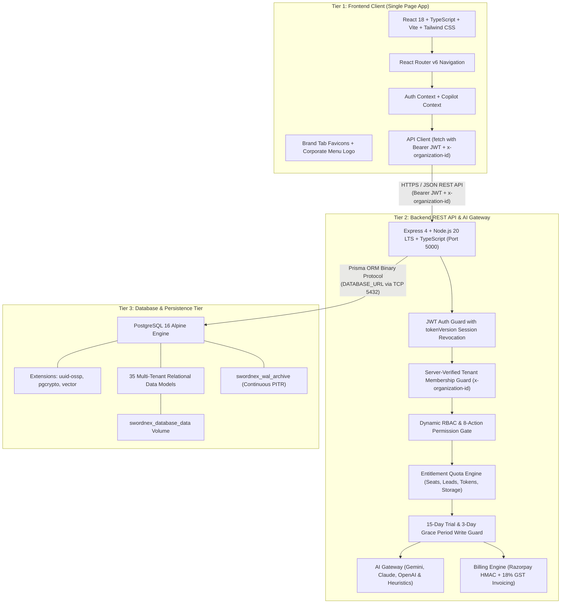

# SwordNex AI CRM — Overall Master System Documentation

> **Company:** SwordNex Technologies Private Limited  
> **Product:** SwordNex AI CRM (Intelligent Enterprise Multi-Tenant Cloud CRM)  
> **Tagline:** *Understand Customers. Predict Opportunities. Accelerate Growth.*  
> **Release Version:** 1.0.0 Production Architecture  
> **System Topology:** Decoupled 3-Tier Multi-Tenant SaaS (React 18 + Node.js 20 LTS + PostgreSQL 16)  
> **API Base URL:** `http://localhost:5000/api/v1`  
> **Frontend URL:** `http://localhost:5173` (Dev) / `http://127.0.0.1:8080` (Internal Prod)  
> **Master HQ Portal:** `http://localhost:5173/swordnex-master/login`  
> **Quality Gate Status:** 155 / 155 Automated Tests Passing (100% Pass Rate across 15 Test Files)  

---

## 1. Executive Summary & Brand Overview

**SwordNex AI CRM** is a next-generation enterprise Customer Relationship Management SaaS platform developed for **SwordNex Technologies Private Limited**. Engineered around a decoupled 3-tier architecture, the platform integrates customer data management, explainable predictive AI lead scoring, autonomous sales agent workflows, Indian SaaS billing with 18% GST invoicing, dynamic RBAC, and multi-tenant workspace isolation.

### Core Architectural Values
- **100% Dynamic Full-Stack**: Zero static mock data. Every dashboard metric, lead profile, deal transition, quota meter, and recalculation queries live PostgreSQL tables through Prisma ORM and Express REST endpoints.
- **Strict Multi-Tenant Isolation**: All organizational data is scoped by `organizationId` verified on the server side via database membership lookup. Cross-tenant queries without valid membership are strictly rejected (`HTTP 403`).
- **Instantaneous Session Revocation**: Backed by database-enforced `tokenVersion`. User logouts, password resets, and administrative revocations invalidate existing JWT access and refresh tokens immediately.
- **Cryptographic Password Recovery**: Implements secure 1-hour expiration SHA-256 hashed password reset tokens with constant-time anti-enumeration public responses.
- **Explainable Predictive AI**: Mathematical multi-factor lead scoring (0–100) and AI Deal Health diagnosis with transparent risk factors and human-in-the-loop oversight queues.
- **Indian SaaS Native**: Configurable INR pricing tiers (Free Trial, Standard @ ₹2,499/mo, Premium @ ₹7,499/mo), cryptographic Razorpay HMAC SHA256 signature verification, and automated 18% GST tax invoices (`INV-YYYY-XXXXX`).

---

## 2. Decoupled 3-Tier Architecture Diagram



---

## 3. Production Multi-Container Network Topology

```
                  Internet Traffic (HTTPS :443 / HTTP :80)
                                    │
                                    ▼
       ┌─────────────────────────────────────────────────────────────┐
       │                Host Reverse Proxy (Nginx)                   │
       │  - Let's Encrypt TLS Termination (Certbot)                  │
       │  - Security Headers (HSTS, CSP, XSS, Sniff)                 │
       │  - Rate Limiting & 15MB Request Body Buffer                 │
       └──────────────┬──────────────────────────────┬───────────────┘
                      │                              │
         Proxy to 127.0.0.1:8080        Proxy /api & /uploads to 127.0.0.1:5000
                      │                              │
                      ▼                              ▼
       ┌──────────────────────────────┐┌──────────────────────────────┐
       │     swordnex_prod_frontend   ││     swordnex_prod_backend    │
       │   - Nginx 1.27 Alpine (SPA)  ││   - Node 20 Alpine (Express) │
       │   - Port 80 internal         ││   - Non-root 'node' user     │
       │                              ││   - Port 5000 internal       │
       └──────────────┬───────────────┘└──────────────┬───────────────┘
                      │                               │
                      └────── crm_app_network ────────┘
                                      │
                      ┌───────────────┴───────────────┐
                      │    crm_db_network (INTERNAL)  │
                      │  (STRICT: ZERO PUBLIC ACCESS) │
                      └───────────────┬───────────────┘
                                      │
                                      ▼
                      ┌───────────────────────────────┐
                      │    swordnex_prod_database     │
                      │   - PostgreSQL 16 Alpine      │
                      │   - Port 5432 (Internal only) │
                      │   - WAL Archiving for PITR    │
                      └───────────────────────────────┘
```

---

## 4. Platform vs. Tenant Roles & Dynamic RBAC Matrix

SwordNex CRM strictly segregates global platform administration from tenant workspace operations:

| Level | Role Type | Location | Responsibilities & Scope |
| :--- | :--- | :--- | :--- |
| **Global Platform** | `SUPER_ADMIN` | `User.globalRole` | Full access to SwordNex Master Head Office (`/swordnex-master`), cross-tenant subscription management, dynamic plan pricing in INR, global MRR/ARR analytics, and immutable platform security audit logs. Must be provisioned securely via server environment, never via public registration. |
| **Global Platform** | `USER` | `User.globalRole` | Standard registered platform identity. Default for all customer signups and invited team members. Lacks access to master head office. |
| **Tenant Workspace** | `ADMIN` (Customer Admin) | `Membership.role` | Administrative authority within the specific tenant organization: invite/manage members, configure custom roles and permissions, initiate plan upgrades/downgrades, and inspect organization audit logs. |
| **Tenant Workspace** | `USER` (Employee) | `Membership.role` | Scoped team member within the organization. Permissions are dynamically governed by an assigned custom `Role` (`Membership.customRoleId`). |

### Dynamic RBAC Module Permission Matrix
Custom roles enforce granular permissions across **8 distinct actions** (`VIEW`, `CREATE`, `EDIT`, `DELETE`, `APPROVE`, `EXPORT`, `ASSIGN`, `MANAGE`) across **12 modules**:
1. `LEADS` — Capture, scoring, layout customization, atomic conversion, and CSV/XLSX import/export.
2. `CONTACTS` — Customer stakeholder management and timeline tracking.
3. `COMPANIES` — Account intelligence, technographic profiling, and revenue tracking.
4. `DEALS` — Visual Kanban pipelines, probability tracking, and deal health analysis.
5. `TASKS` — Action item assignment, due dates, and activity feeds.
6. `EMPLOYEES` — Organization member roster, title management, and seat limits.
7. `REPORTS` — Pipeline velocity, sales rep performance, and revenue forecasting.
8. `SETTINGS` — Workspace customization, currency, domains, and branding.
9. `BILLING` — SaaS plan checkout, seat upgrades, and 18% GST tax invoices.
10. `WORKFLOWS` — Event-driven trigger-condition-action automations.
11. `AI_CENTER` — Lead scoring simulator, Copilot chat, and email drafter.
12. `COMMS` — Email, SMS, and WhatsApp communication timeline.

---

## 5. PostgreSQL 16 Data Architecture (35 Relational Models)

The relational schema is partitioned into functional domains:

1. **Identity, Workspaces & Permissions**: `User`, `Organization`, `Membership`, `Role`, `RolePermission`, `AuditLog`.
2. **Sales Pipeline & CRM Core**: `Lead`, `Deal`, `Pipeline`, `PipelineStage`, `Contact`, `Company`, `Activity`, `Task`.
3. **CPQ & Commercial Billing**: `Product`, `Quote`, `QuoteItem`, `CustomerInvoice`, `CustomerInvoiceItem`.
4. **SaaS Subscription & Invoicing**: `Plan`, `Subscription`, `Invoice`, `PaymentWebhookEvent`.
5. **Customer Support & Service**: `Ticket`, `TicketMessage`.
6. **Marketing & Communications**: `Campaign`, `CommunicationLog`.
7. **Automation & AI Configuration**: `Workflow`, `WorkflowExecution`, `LeadLayoutConfig`, `LeadImportHistory`.

---

## 6. Indian SaaS Subscription & GST Billing Engine

- **Automated 15-Day Free Trial**: Triggered upon organization registration. Provides 5 seats, 15,000 lead capacity, and full CRM module access.
- **3-Day Grace Period**: Upon plan expiration, the organization enters a 72-hour grace period with banner notifications before write locks are enforced.
- **Configurable Indian SaaS Tiers**:
  - `Free Trial`: ₹0 / 15 days (5 seats, 15,000 leads)
  - `Standard`: ₹2,499 / month (10 seats, 50,000 leads)
  - `Premium`: ₹7,499 / month (Unlimited seats, unlimited leads, dedicated AI credits)
- **Razorpay Checkout & Webhook Security**:
  - Cryptographic server-side order calculation in INR.
  - Timing-safe HMAC SHA-256 signature verification (`crypto.timingSafeEqual`).
  - Raw body buffer validation (`req.rawBody`) for exact byte verification.
  - Idempotent deduplication via `PaymentWebhookEvent`.
- **18% Indian GST Tax Invoicing**: Automatically generates serial tax invoices (`INV-YYYY-XXXXX`) calculating CGST (9%) + SGST (9%) or IGST (18%) with printable receipts.

---

## 7. AI Gateway & Autonomous Sales Agents

- **Multi-Provider Architecture**: Dynamic switching between Google Gemini (`gemini-1.5-pro`), OpenAI (`gpt-4o`), Anthropic Claude (`claude-3-5-sonnet`), and a built-in deterministic heuristic fallback (`mock`).
- **Prompt Injection Guard**: Rigorous input sanitization and delimiter escaping before LLM synthesis.
- **Explainable Predictive Lead Scoring**: 0–100 score with confidence ratings and positive/negative contributing factors.
- **Deal Health Risk Analyzer**: Evaluates stage duration, activity frequency, and engagement sentiment.
- **Human-in-the-Loop Approval Queue**: Sensitive autonomous actions (e.g., bulk email dispatches, deal stage promotions) require human approval.

---

## 8. Complete Lead Import & Export Engine

- **Drag-and-Drop Ingestion**: Supports `.csv`, `.xlsx`, and `.xls` files up to 10 MB.
- **Dynamic Field Mapping**: Auto-detects columns and maps them to standard and custom lead fields.
- **Pre-Import Preview & Validation**: Verifies email formats, phone numbers, and required fields before committing to database.
- **Duplicate Strategy Selection**: Choose between `SKIP`, `UPDATE`, or `CLONE` for duplicate records.
- **Comprehensive Audit Trail**: Tracks batch import logs, processed counts, success rates, and downloadable error summaries.

---

## 9. Quality Gate & Automated Testing Summary

SwordNex AI CRM enforces a 100% automated test pass rate across 15 comprehensive test suites:

```text
 ✓ tests/lead-import-export.test.ts (20 tests)
 ✓ tests/security-razorpay-password.test.ts (17 tests)
 ✓ tests/production-deployment-verification.test.ts (13 tests)
 ✓ tests/tickets-sales-phase1.test.ts (14 tests)
 ✓ tests/security-entitlements.test.ts (13 tests)
 ✓ tests/commercial-cpq-finance.test.ts (12 tests)
 ✓ tests/phase3-modules-ai.test.ts (10 tests)
 ✓ tests/rbac-subscription.test.ts (15 tests)
 ✓ tests/production-readiness-remediation.test.ts (9 tests)
 ✓ tests/security-phase2.test.ts (8 tests)
 ✓ tests/lead-layout.test.ts (6 tests)
 ✓ tests/subscription-engine.test.ts (12 tests)
 ✓ tests/ai.test.ts (2 tests)
 ✓ tests/auth.test.ts (3 tests)
 ✓ tests/tenant.test.ts (1 test)

 Test Files  15 passed (15)
      Tests  155 passed (155)
   Duration  28.77s
```

---

## 10. Documentation Index & Cross-References

| Document | Purpose |
| :--- | :--- |
| **[`README.md`](../README.md)** | Root project overview, quick start, demo credentials, and build instructions. |
| **[`docs/ARCHITECTURE.md`](ARCHITECTURE.md)** | Detailed decoupled 3-tier system architecture and tenant scoping principles. |
| **[`docs/API.md`](API.md)** | Complete REST API endpoint reference and parameter specifications. |
| **[`docs/PRODUCTION_DEPLOYMENT.md`](PRODUCTION_DEPLOYMENT.md)** | Ubuntu Linux deployment, Docker Compose topology, and host Nginx reverse proxy. |
| **[`docs/DEPLOYMENT.md`](DEPLOYMENT.md)** | Production operations, zero-downtime rolling deploys, and incident runbook. |
| **[`docs/SECURITY.md`](SECURITY.md)** | Security architecture, double-secret JWT, timing-safe checks, and hardening matrix. |
| **[`docs/DATABASE.md`](DATABASE.md)** | PostgreSQL 16 schema, Prisma migrations, WAL continuous archiving, and PITR runbook. |

---

© 2026 **SwordNex Technologies Private Limited**. All Rights Reserved.
