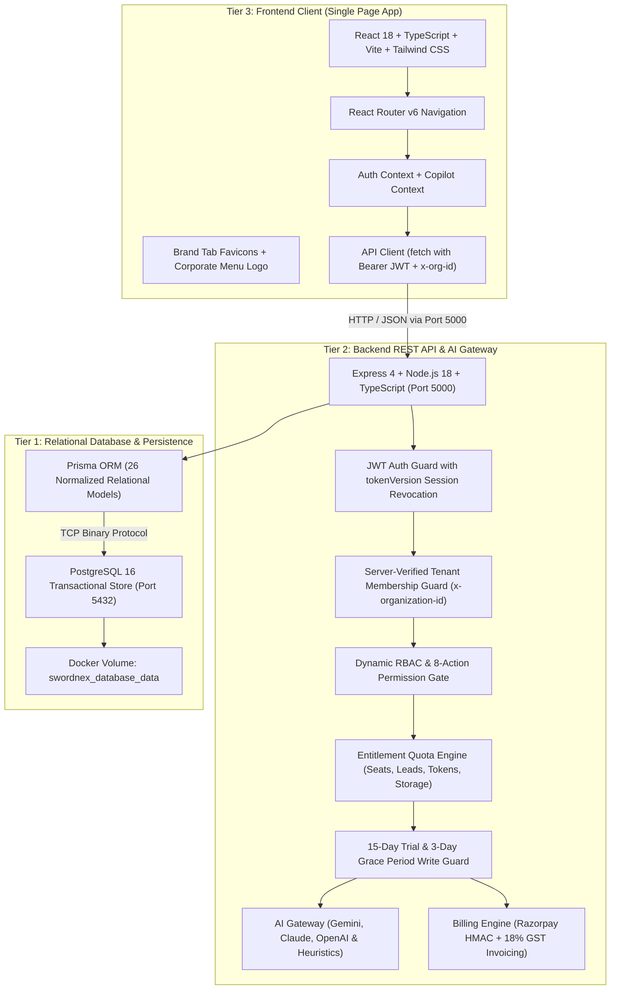
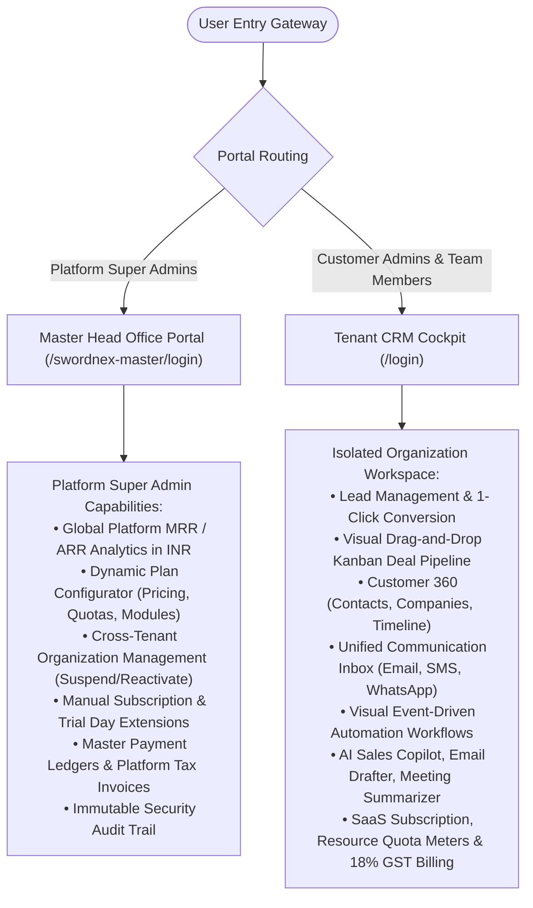
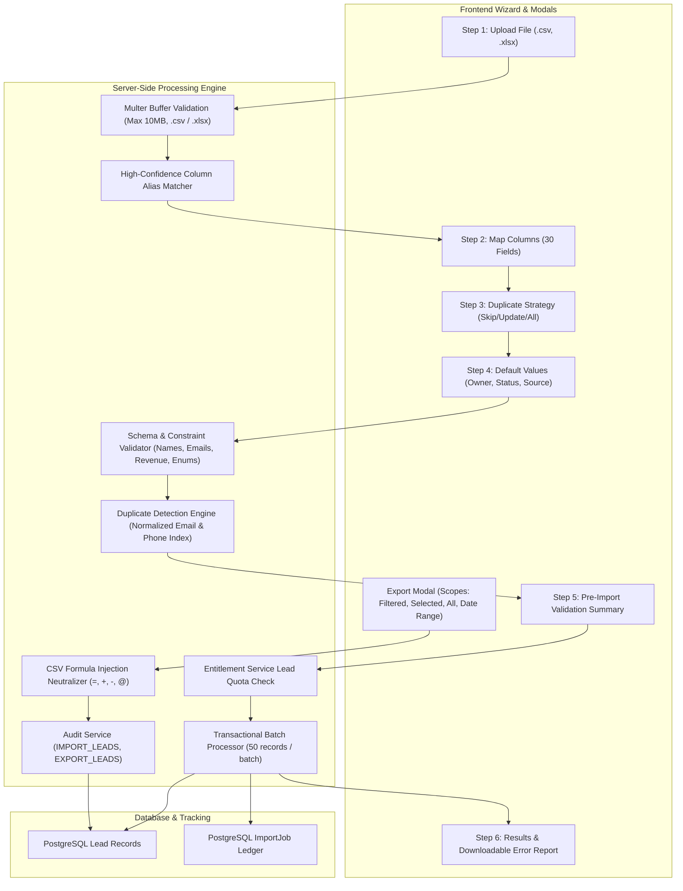

# SwordNex AI CRM — Overall Master System Documentation

> **Company:** SwordNex Technologies Private Limited  
> **Product:** SwordNex AI CRM (Intelligent Enterprise Multi-Tenant Cloud CRM)  
> **Tagline:** *Understand Customers. Predict Opportunities. Accelerate Growth.*  
> **Release Version:** 1.0.0 Production Architecture  
> **System Topology:** Decoupled 3-Tier Multi-Tenant SaaS (React 18 + Node.js 18 + PostgreSQL 16)  
> **API Base URL:** `http://localhost:5000/api/v1`  
> **Frontend URL:** `http://localhost:5173`  
> **Master HQ Portal:** `http://localhost:5173/swordnex-master/login`  
> **Quality Gate Status:** 90 / 90 Automated Tests Passing (100% Pass Rate across 10 Test Files)  

---


## 1. Executive Summary & Brand Overview

**SwordNex AI CRM** is a modern, high-performance, enterprise SaaS Customer Relationship Management system developed for **SwordNex Technologies Private Limited**. Engineered around a decoupled 3-tier architecture, the platform integrates customer data management, explainable predictive AI lead scoring, autonomous sales agent workflows, Indian SaaS billing with 18% GST invoicing, dynamic RBAC, and multi-tenant workspace isolation.

### Core Architectural Values:
- **100% Dynamic Full-Stack**: Zero static mock files. Every view, transaction, quota meter, and recalculation queries live PostgreSQL tables through Prisma ORM and Express REST endpoints.
- **Strict Multi-Tenant Isolation**: All organizational data is scoped by `organizationId` verified on the server side via database membership lookup. Foreign organization header overrides are strictly rejected (`HTTP 403`).
- **Instantaneous Session Revocation**: Backed by database-enforced `tokenVersion`. User logouts, password resets, and administrative revocations invalidate existing JWT access and refresh tokens immediately.
- **Cryptographic Password Recovery**: Implements secure 1-hour expiration SHA-256 hashed password reset tokens with timing-attack safe responses.
- **Explainable Predictive AI**: Mathematical multi-factor lead scoring (0–100) and AI Deal Health diagnosis with transparent risk factors and human-in-the-loop oversight queues.
- **Indian SaaS Native**: Configurable INR pricing tiers (Free Trial, Standard @ ₹2,499/mo, Premium @ ₹7,499/mo), cryptographic Razorpay HMAC SHA256 signature verification, and automated 18% GST tax invoices (`INV-YYYY-XXXXX`).

---

## 2. Decoupled 3-Tier Architecture Diagram



---

## 3. Platform Portals & Security Role Boundaries

SwordNex AI CRM separates platform governance from customer tenant operations:



### Role Matrix & Hierarchy

| Role Scope | Role Name | Enforcement Field | Scope & Authorities |
|---|---|---|---|
| **Platform Scope** | `SUPER_ADMIN` | `User.globalRole` | Full administrative authority across the entire platform, all customer workspaces, SaaS plan definitions, and global revenue ledgers. Strict server-side assignment. |
| **Platform Scope** | `USER` | `User.globalRole` | Standard user identity for all tenant signups and invited teammates. Access to `/swordnex-master/*` is strictly forbidden (`HTTP 403`). |
| **Tenant Scope** | `ADMIN` (Workspace Owner) | `Membership.role` | Administrative control inside the tenant workspace: manage teammates, adjust custom roles, upgrade plans, download invoices. |
| **Tenant Scope** | `AGENT` / `USER` (Employee) | `Membership.role` | Standard team seat inside the workspace. Specific abilities are determined by dynamic custom roles (`Membership.customRoleId`). |
| **Custom Dynamic RBAC** | Custom Role Matrix | `Role` & `RolePermission` | Custom granular permissions across 8 distinct actions (`VIEW`, `CREATE`, `EDIT`, `DELETE`, `APPROVE`, `EXPORT`, `ASSIGN`, `MANAGE`) across 12 modules. |

---

## 4. Complete Functional Modules Breakdown (14 Modules)

### 1. Executive AI Cockpit & Dashboard (`/dashboard`)
- Real-time revenue velocity, win rates, active pipeline totals, overdue tasks, and lead volume.
- Interactive charts: Stage Volume Distribution and Acquisition Channel Attribution.
- Contextual shortcuts to ask the AI Sales Copilot questions grounded in live tenant data.

### 2. Lead Management, Predictive AI Scoring & Enterprise Import/Export (`/leads`)
- **Full-Lifecycle Lead Ingestion**: Ingest leads from webhooks, contact forms, interactive UI creation, and bulk CSV / Excel spreadsheet imports.
- **Multi-Factor Explainable AI Scoring**: Computes composite lead intelligence scores (0–100) analyzing role seniority, corporate domain authenticity, activity volume, and purchase intent.
- **One-Click Atomic Lead Conversion**: Atomic PostgreSQL transaction converting leads into connected `Contact`, `Company`, and `Deal` records.
- **Production-Ready Multi-Step Lead Import Wizard**:
  - Drag-and-drop file upload supporting `.csv` and `.xlsx` up to 10MB.
  - Automatic column mapping using intelligent alias matching across 30 standard CRM fields.
  - Configurable duplicate detection based on normalized email and phone numbers with three execution strategies: *Skip duplicates*, *Update existing leads*, or *Import all rows*.
  - Live pre-import validation summary and diagnostic preview highlighting valid, invalid, duplicate, and estimated records.
  - Execution in controlled database batches with detailed failure reporting and downloadable CSV/Excel error reports.
- **Advanced Multi-Scope Leads Export Engine**:
  - Scopes: *Filtered Leads*, *Selected Leads* (via table checkboxes), *All Leads*, or *Date Range*.
  - Dual format outputs: RFC 4180 CSV with UTF-8 BOM (for Excel multilingual support) and Microsoft Excel (`.xlsx`) workbooks.
  - Configurable column selection with custom ordering.
  - Anti-Formula Injection protection (prepending `'` to `=`, `+`, `-`, `@`, `\t`, `\r`) mitigating spreadsheet macro execution risks.
- **Audit-Logged Import History**: Persistent tracking via `ImportJob` relational model capturing original filenames, row metrics, error diagnostics, and status lifecycle.


### 3. Interactive Kanban Deal Pipeline (`/deals`)
- Visual drag-and-drop stage progression: `New` → `Qualified` → `Discovery` → `Proposal` → `Negotiation` → `Won` / `Lost`.
- Real-time AI Deal Health diagnosis flagging stalled opportunities, days in stage, and recommended risk mitigations.
- Multi-pipeline switcher and weighted pipeline forecasting.
- **Enterprise RFC 4180 CSV Data Export**: `GET /api/v1/deals/export/csv` protected by `requirePermission('DEALS', 'EXPORT')` exporting pipeline stage, probability weightings, and commercial totals.

### 4. Contacts Directory (`/contacts`)
- Stakeholder profiles with department, lifecycle stages (`LEAD`, `MQL`, `SQL`, `CUSTOMER`), phone, and email.
- Real-time search, filtering, and direct links to parent companies.
- **Enterprise RFC 4180 CSV Data Export**: `GET /api/v1/contacts/export/csv` protected by `requirePermission('CONTACTS', 'EXPORT')` with customer stakeholder and company attribution.

### 5. Accounts & Customer 360 (`/companies`)
- Corporate profiling: Industry, employee headcount, annual revenue, website, and technographics.
- Account Health Score (0–100) and Churn Risk Indexing (`LOW`, `MEDIUM`, `HIGH`).

### 6. Tasks & Follow-up Sequences (`/tasks`)
- Actionable task tracking categorized by `CALL`, `EMAIL`, `MEETING`, and `FOLLOW_UP`.
- Priority levels (`LOW`, `MEDIUM`, `HIGH`, `URGENT`) and automated overdue detection.

### 7. Unified Communication Hub (`/inbox`)
- Consolidated multi-channel communication timeline for Corporate Email (SMTP), Twilio SMS, and WhatsApp Business API.
- Real-time message status tracking (`QUEUED`, `SENT`, `DELIVERED`, `READ`, `FAILED`).
- **Inbound Webhook & Callback Engine**: Public endpoint `POST /api/v1/comms/webhook/:provider` ingesting delivery receipts (`DELIVERED`, `READ`, `FAILED`) and inbound customer messages, auto-associating with tenant conversations.
- Honest limitation reporting: logs explicit simulation notes if external gateway credentials are unconfigured.

### 8. Campaigns Management (`/campaigns`)
- Omnichannel outbound campaign orchestrator across Email, SMS, and WhatsApp.
- Budget allocation, conversion tracking, recipient targeting, and ROI analytics.
- **Anti-Spam & Consent Suppression**: Automated suppression of unsubscribed contacts against `ConsentRecord` prior to dispatch (`POST /api/v1/campaigns/:id/send`).
- **One-Click Unsubscribe Endpoint**: Public `POST /api/v1/campaigns/unsubscribe` adhering to CAN-SPAM, GDPR, and DPDP Act 2023 compliance.

### 9. AI Center & Autonomous Sales Agents (`/ai-center`)
- **Explainable Lead Scoring Simulator**: Interactive simulator showing real-time score calculation breakdowns.
- **Live LLM Integration**: Multi-provider support for Google Gemini (`gemini-1.5-flash`) and OpenAI (`gpt-4o-mini`) with automatic fallback to internal reasoning engine on timeout or unconfigured keys.
- **Dynamic Meeting Transcript Summarizer**: Intelligently parses transcript text, detects speakers, extracts actionable commitments with owners and deadlines, and classifies customer sentiment (`POSITIVE`, `NEUTRAL`, `SKEPTICAL`, `CHALLENGING`).
- **Context-Aware Sales Copilot**: Dynamic prompt assistant synthesizing actionable guidance from live tenant database records.
- **Sales Email Drafter**: Multi-tone, objective-driven email generator personalized to recipient and key commercial points.
- **Autonomous Agents**: Autonomous lead research agents with Human-in-the-Loop approval queues for high-risk actions.

### 10. Visual Automation Workflow Builder (`/workflows`)
- Event-driven automation engine: `Trigger → Conditions → Actions → Execution Logs`.
- Triggers on lifecycle events (deal stage changed, lead status updated, task completed).
- Automated actions include task creation, notification dispatch, and field updates.

### 11. Reports & Forecasting (`/reports`)
- Comprehensive sales velocity charts, pipeline health analytics, lead conversion funnels, and exportable reports.

### 12. SaaS Subscription, Trial & 18% GST Invoicing (`/billing`)
- 15-day automated Free Trial with 3-day grace period enforcement.
- Real-time resource quota meters: Seat utilization, lead capacity, AI token consumption, storage.
- Razorpay / Cashfree order checkout simulation with cryptographic HMAC signature verification.
- Automated Indian GST-compliant (18%) tax invoices (`INV-YYYY-XXXXX`) with printable receipts.

### 13. Team Management & Invitations (`/team`)
- Secure teammate invitation modal assigning standard tenant roles (`ADMIN`, `AGENT`).
- Member status controls (`ACTIVE`, `PENDING`, `INACTIVE`) and team grouping.

### 14. Roles, Permissions & Security Settings (`/settings`)
- Dynamic custom role builder with 8-action permission toggles across 12 modules.
- Immutable security audit logs recording all organizational mutations.

---

## 5. Security & Authentication Architecture (Phase 2 Enhanced)

### 5.1. Session Revocation via `tokenVersion`
- Every user account maintains a `tokenVersion` integer in PostgreSQL.
- Both Access Tokens (`1d`) and Refresh Tokens (`7d`) encode `tokenVersion` inside their cryptographic payload.
- Upon calling `POST /api/v1/auth/logout` or resetting/changing password, `tokenVersion` is atomically incremented on the database record.
- [auth.middleware.ts](file:///e:/SNCRM/server/src/middleware/auth.middleware.ts) validates `payload.tokenVersion === user.tokenVersion` on every incoming API request. If mismatched, access is immediately blocked with `HTTP 401 Session revoked`.

### 5.2. Cryptographic Password Reset Flow
- **Request Endpoint**: `POST /api/v1/auth/forgot-password` generates a high-entropy random token (`crypto.randomBytes(32)`).
- **Storage**: Only the SHA-256 hash of the token is saved to the database with a strict 1-hour expiration timestamp.
- **Confirmation Endpoint**: `POST /api/v1/auth/reset-password` matches the SHA-256 hash, hashes the new password with bcrypt (10 rounds), invalidates the token, and increments `tokenVersion` to revoke all existing sessions.
- **Change Password**: `POST /api/v1/auth/change-password` requires the current password, verifies via bcrypt, updates to the new password, and increments `tokenVersion`.

### 5.3. Payment Gateway Security
- In production (`NODE_ENV === 'production'`), [subscription.controller.ts](file:///e:/SNCRM/server/src/controllers/subscription.controller.ts) strictly requires `RAZORPAY_KEY_SECRET` and validates the HMAC SHA-256 signature (`orderId|paymentId`). Tampered or unsigned requests are rejected with `HTTP 400 Cryptographic payment signature verification failed`.

---

## 6. SaaS Subscription & 18% GST Tax Invoicing Engine

### Subscription Tiers (Native INR Pricing)

| Feature / Quota | 15-Day Free Trial | Standard Plan | Premium AI Suite |
|---|---|---|---|
| **Plan Slug** | `FREE_TRIAL` | `STANDARD` | `PREMIUM` |
| **Monthly Price** | ₹0 | **₹2,499** / month | **₹7,499** / month |
| **Yearly Price** | ₹0 | **₹24,990** / year *(~17% discount)* | **₹74,990** / year *(~17% discount)* |
| **User Seats** | 5 Seats | 10 Seats | 50 Seats |
| **Custom Roles** | 5 Custom Roles | 10 Custom Roles | Unlimited |
| **Lead Capacity** | 15,000 Leads | 25,000 Leads | 100,000 Leads |
| **Monthly AI Tokens** | 500,000 Tokens | 1,000,000 Tokens | 5,000,000 Tokens |
| **Cloud Storage** | 1,000 MB (1 GB) | 5,000 MB (5 GB) | 25,000 MB (25 GB) |
| **Included Modules** | Core CRM + Reports | Core CRM + Comms + Workflows | All 14 Modules + AI Center + APIs |
| **18% GST Invoices** | Printable Confirmation | Official Tax Receipt (`INV-YYYY-XXXXX`) | Official Tax Receipt (`INV-YYYY-XXXXX`) |

### Automated Enforcement Rules:
1. **Seat Gate**: Inviting a teammate checks current seat count against plan quota before persisting. Exceeding quota returns `HTTP 402 Payment Required`.
2. **Lead Gate**: Ingesting leads verifies total database volume against plan capacity.
3. **AI Token Gate**: Every AI Copilot or scoring prompt meters token consumption in real time.
4. **15-Day Trial Expiration**: Authoritative server timestamps govern trial expiration. When expired, a 3-day grace period allows read access while blocking write operations.
5. **Zero Data Loss**: Downgrades or expirations never purge customer records. Historical data remains intact.

---

## 7. Preloaded Demo Seed Credentials

All preloaded test accounts use the universal password: **`SwordNex2026!`**

| Portal | URL | Role | Name | Email | Organization | Status |
|---|---|---|---|---|---|---|
| **Master Platform** | `/swordnex-master/login` | `SUPER_ADMIN` | **Kaja Najbudeen** | `admin@swordnex.com`<br>`kaja@swordnex.com` | SwordNex Platform HQ | Full Global Authority |
| **Tenant CRM** | `/login` | `ADMIN` | **Aneee** | `aneee@swordnex.com` | SwordNex Technologies Global | Active (Premium Plan) |
| **Tenant CRM** | `/login` | `AGENT` | **Venkat** | `venkat@swordnex.com` | SwordNex Technologies Global | Active (Standard Seat) |
| **Tenant CRM** | `/login` | `ADMIN` | **Rahul Nexus** | `rahul.nexus@example.com` | Nexus Innovations | 15-Day Free Trial (Active) |
| **Tenant CRM** | `/login` | `ADMIN` | **Kavita Media** | `kavita.media@example.com` | Starlight Media | Suspended Org (Write Locked) |

---

## 8. Brand Assets & Visual Identity

```
client/public/
├── favicon.ico                 # Standard multi-resolution Windows/browser icon
├── favicon-16x16.png           # 16x16 crisp favicon
├── favicon-32x32.png           # 32x32 standard retina favicon
├── logo192.png                 # 192x192 mobile / PWA application icon
├── tab-icon.png                # 512x512 high-res square browser tab icon
├── tab-icon-transparent.png    # 512x512 transparent background variant
├── menu-logo.png               # Official horizontal corporate logo
├── menu-logo-dark.png          # High-contrast luminous logo for dark headers
└── menu-logo-card.png          # Soft white card badge presentation
```

- **Browser Tab Favicon**: Hexagonal royal blue **S** icon loaded in `client/index.html`.
- **Sidebar Menu Logo**: The wide **SwordNex Technologies PVT. LTD** banner logo with the tagline *"Your Trust, Our Vision"* is embedded in the main navigation sidebar, Master Head Office navigation, and login portals.

---

## 9. Quality Gates & Automated Test Coverage

```
Test Files  10 passed (10)
     Tests  90 passed (90)
  Duration  17.26s
```

### Verified Test Suites:
- `tests/lead-import-export.test.ts` (20 tests) — Complete import/export feature verification: CSV & Excel sample templates, MIME type and format parsing, intelligent column auto-mapping, required and format validation, Unicode character fidelity, duplicate detection strategies (`SKIP`, `UPDATE`, `IMPORT_ALL`), error report generation, formula injection neutralization (`=`, `+`, `-`, `@`), scopes (`ALL`, `FILTERED`, `SELECTED`, `DATE_RANGE`), tenant isolation, foreign owner rejection, and RBAC permission enforcement.
- `tests/lead-layout.test.ts` (6 tests) — Lead creation, editing, dynamic layout configuration persistence, custom fields validation, and foreign organization owner assignment rejection.
- `tests/phase3-modules-ai.test.ts` (10 tests) — RFC 4180 CSV exports for Leads, Contacts, and Deals with RBAC checks; inbound webhook status callbacks; anti-spam opt-out suppression; and dynamic AI meeting summarization.
- `tests/security-phase2.test.ts` (8 tests) — Session revocation via `tokenVersion`, SHA-256 password reset flow, IDOR prevention, and cryptographic HMAC payment checks.
- `tests/security-entitlements.test.ts` (13 tests) — Tenant isolation, public registration safety, invite privilege checks, quota enforcement, webhook replay prevention, and prompt injection defense.
- `tests/rbac-subscription.test.ts` (15 tests) — Dynamic custom roles, module permission checks, and plan quota gates.
- `tests/subscription-engine.test.ts` (12 tests) — 15-day trial arithmetic, 3-day grace period, upgrade/downgrade lifecycles, and 18% GST calculation.
- `tests/auth.test.ts` (3 tests) — Invalid credential rejection, JWT generation, and route protection.
- `tests/ai.test.ts` (2 tests) — Multi-factor predictive lead scoring formulas.
- `tests/tenant.test.ts` (1 test) — Cross-tenant boundary enforcement.

---

## 10. Production Lead Import & Export Subsystem Architecture

### 10.1. Subsystem Workflow Overview

The Lead Import & Export subsystem provides an end-to-end pipeline allowing users to bulk-ingest and export lead records with tenant isolation, duplicate detection, and security protections.



---

### 10.2. Supported CRM Fields & Aliases

The system supports mapping across all 30 Lead model attributes:

| Field Key | Label | Type | Required | Primary Aliases Recognized |
|---|---|---|---|---|
| `firstName` | First Name | `string` | **Yes** | `first name`, `firstname`, `first_name`, `fname`, `given name` |
| `lastName` | Last Name | `string` | **Yes** | `last name`, `lastname`, `last_name`, `lname`, `surname` |
| `company` | Company | `string` | No | `company`, `company name`, `organization`, `account`, `business` |
| `title` | Title / Job Title | `string` | No | `title`, `job title`, `designation`, `position`, `role` |
| `email` | Primary Email | `string` | No | `email`, `email address`, `e-mail`, `mail`, `work email` |
| `secondaryEmail` | Secondary Email | `string` | No | `secondary email`, `alt email`, `alternate email`, `personal email` |
| `phone` | Phone | `string` | No | `phone`, `telephone`, `phone number`, `tel`, `work phone` |
| `mobile` | Mobile | `string` | No | `mobile`, `cell`, `mobile phone`, `cell phone`, `cellular` |
| `fax` | Fax | `string` | No | `fax`, `facsimile`, `fax number` |
| `website` | Website | `string` | No | `website`, `url`, `web`, `site`, `homepage`, `domain` |
| `ownerId` | Lead Owner | `string` | No | `lead owner`, `owner`, `assigned to`, `assignee`, `sales rep` |
| `source` | Lead Source | `enum` | No | `lead source`, `source`, `channel`, `origin`, `acquisition channel` |
| `status` | Lead Status | `enum` | No | `lead status`, `status`, `stage`, `lead state` |
| `priority` | Lead Priority | `enum` | No | `priority`, `lead priority`, `urgency` |
| `industry` | Industry | `string` | No | `industry`, `sector`, `vertical`, `business category` |
| `annualRevenue` | Annual Revenue | `number` | No | `annual revenue`, `revenue`, `turnover`, `arr` |
| `numberOfEmployees`| Number of Employees | `number` | No | `number of employees`, `employees`, `employee count`, `team size` |
| `rating` | Rating | `enum` | No | `rating`, `lead rating`, `tier`, `temperature` (`HOT`, `WARM`, `COLD`) |
| `emailOptOut` | Email Opt Out | `boolean` | No | `email opt out`, `opt out`, `unsubscribed`, `do not email` |
| `skypeId` | Skype ID | `string` | No | `skype id`, `skype`, `skype name` |
| `twitterHandle` | Twitter Handle | `string` | No | `twitter handle`, `twitter`, `x handle`, `twitter username` |
| `address` | Flat / House / Building | `string` | No | `address`, `flat`, `house`, `building`, `apartment`, `address line 1` |
| `street` | Street Address | `string` | No | `street`, `street address`, `address line 2`, `road` |
| `country` | Country / Region | `string` | No | `country`, `country / region`, `region`, `nation` |
| `state` | State / Province | `string` | No | `state`, `state / province`, `province`, `territory` |
| `city` | City | `string` | No | `city`, `town`, `municipality` |
| `zipCode` | ZIP / Postal Code | `string` | No | `zip`, `zip code`, `postal code`, `postcode`, `pincode` |
| `latitude` | Latitude | `number` | No | `latitude`, `lat` (-90 to 90) |
| `longitude` | Longitude | `number` | No | `longitude`, `long`, `lng` (-180 to 180) |
| `description` | Description Notes | `string` | No | `description`, `notes`, `comments`, `details`, `summary` |

---

### 10.3. Duplicate Detection & Resolution Engine

- **Normalization**:
  - Emails are normalized via `email.trim().toLowerCase()`.
  - Phone numbers are normalized to E.164/digit-only formats via `phone.replace(/[^\d+]/g, '')`.
- **Indexed Lookup**: Queries leverage PostgreSQL composite indexes (`[organizationId, email]`, `[organizationId, phone]`, `[organizationId, mobile]`) to query thousands of leads with low latency.
- **Handling Strategies**:
  1. **SKIP**: Leaves the existing CRM lead intact; ignores duplicate spreadsheet rows and logs them in the `skippedCount` metric.
  2. **UPDATE**: Updates existing lead attributes with newly supplied non-empty values without touching protected or system fields.
  3. **IMPORT_ALL**: Inserts each duplicate as an independent new record when organizational business policy permits.

---

### 10.4. Security Protections & Formula Injection Defense (CWE-1236)

- **Formula Escaping**: Spreadsheets exported from the backend or downloaded as error reports pass through `sanitizeFormulaInjection()`. Any cell beginning with `=`, `+`, `-`, `@`, `\t`, or `\r` is escaped with a prepended single quote `'`, preventing spreadsheet viewers from executing malicious macro commands.
- **File Input Hardening**: Enforces a 10MB file ceiling, maximum 5 worksheets, maximum 100 columns, and maximum 10,000 rows. Corrupted files or unsupported binary payloads are rejected during initial inspection.
- **Tenant Isolation**: Every lead query, duplicate check, and import job lookup is strictly scoped to `req.organizationId`. Assigned Lead Owners must hold active `Membership` in the organization.
- **Mass Assignment Prevention**: Only approved Lead attributes can be written; client payloads cannot specify `organizationId`, `id`, `createdAt`, or privilege roles.
- **Subscription Quota Guard**: Prevents import execution if the organization's total lead count exceeds the subscription plan limit (`EntitlementService.checkLeadLimit`).
- **Comprehensive Audit Trail**: Records `IMPORT_LEADS` and `EXPORT_LEADS` entries in `AuditLog` capturing user ID, client IP, user agent, record counts, and applied filters.

---

### 10.5. API Endpoints Reference

| Method | Endpoint | Permission | Description |
|---|---|---|---|
| `GET` | `/api/v1/leads/import/template` | Public/Auth | Download formatted CSV or Excel sample import templates. |
| `POST` | `/api/v1/leads/import/upload` | `LEADS:CREATE` | Multipart upload, spreadsheet inspection, and header auto-mapping. |
| `POST` | `/api/v1/leads/import/preview` | `LEADS:CREATE` | Pre-import validation, duplicate simulation, and metric preview. |
| `POST` | `/api/v1/leads/import/execute` | `LEADS:CREATE` | Batch execution with duplicate strategy, quota guard, and error capture. |
| `GET` | `/api/v1/leads/import/history` | `LEADS:VIEW` | Retrieve past import job history for the active organization. |
| `GET` | `/api/v1/leads/import/jobs/:id` | `LEADS:VIEW` | Retrieve job details, status, and failure diagnostics. |
| `GET` | `/api/v1/leads/import/jobs/:id/error-report` | `LEADS:VIEW` | Download CSV or Excel error report containing row numbers and error reasons. |
| `POST` | `/api/v1/leads/export` | `LEADS:EXPORT` | Advanced export supporting scopes (`ALL`, `FILTERED`, `SELECTED`, `DATE_RANGE`) and custom column subsets. |
| `GET` | `/api/v1/leads/export/csv` | `LEADS:EXPORT` | Legacy direct CSV download respecting active query filters. |

